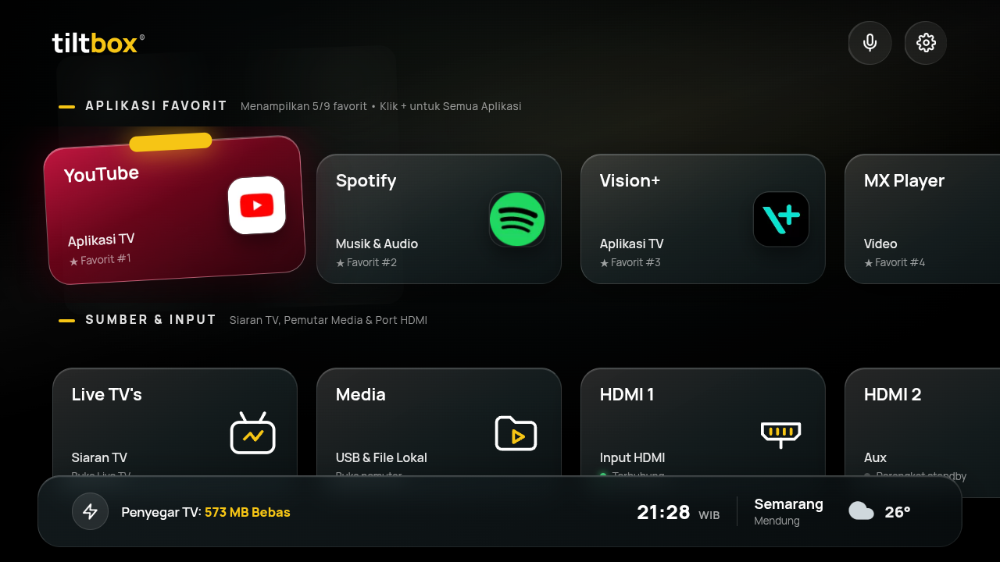
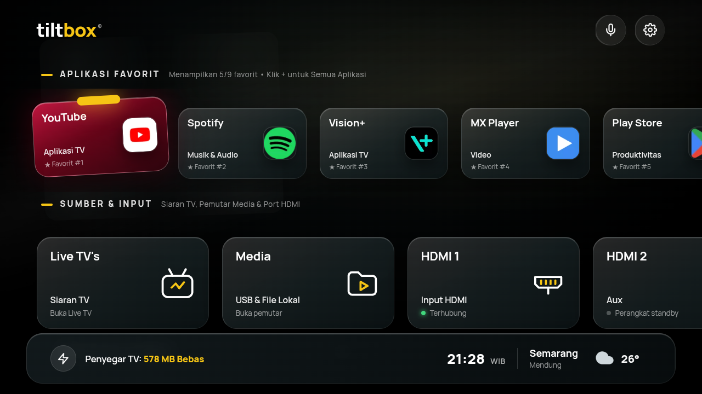
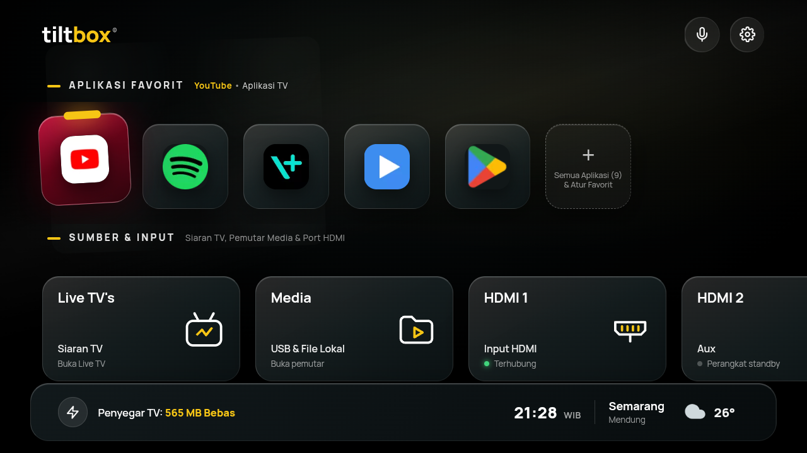
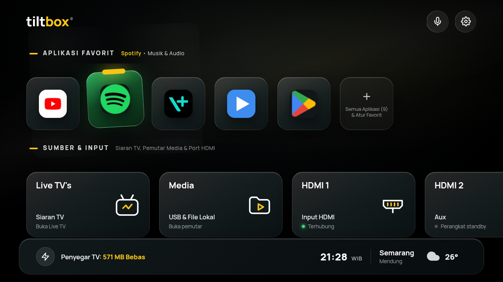
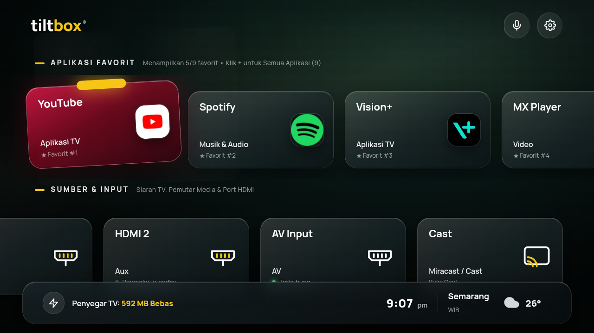
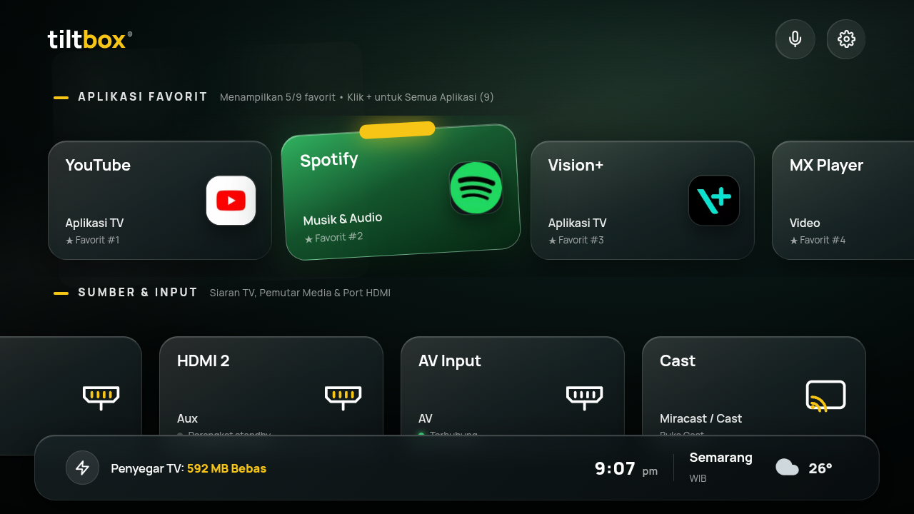
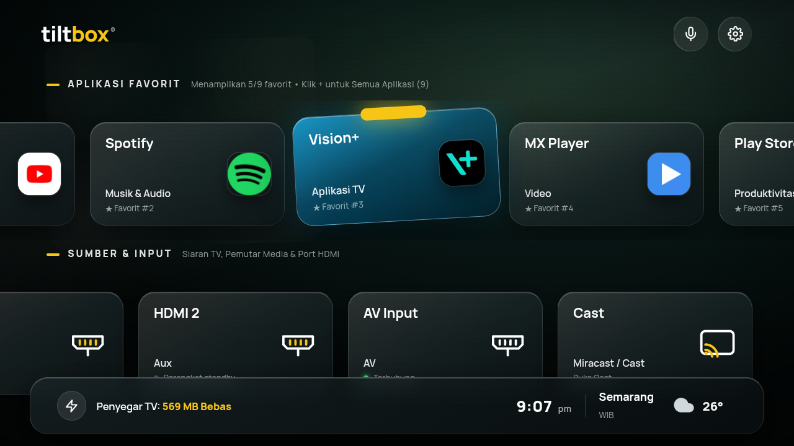
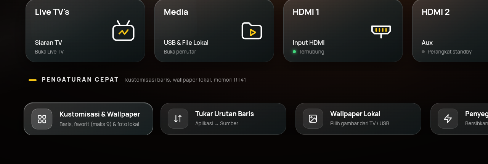

# Tiltbox Launcher v1.8.0 — Card Sizes, Brand Colors & Smart Clock

Launcher Android TV modern dengan antarmuka hybrid Kotlin + WebView, dirancang khusus untuk **TCL Chassis RT41** (`Realtek RTD2841 / RTD2851`, Android TV 9 Pie `V8-R41KT01-LF1V343`).

## Screenshots

### Tampilan Utama — Ukuran Kartu Besar (L)
> Kartu YouTube fokus dengan siluet merah khas brand, jam 24 jam `21:28 WIB`, cuaca Semarang `Mendung 26°`



### Tampilan Utama — Ukuran Kartu Sedang (M)
> Layout kompak, lebih banyak kartu tampil dalam satu baris



### Tampilan Utama — Ukuran Kartu Kecil (S)
> Mode pure icon square. Subtitle dinamis `App • Kategori` muncul di judul baris saat fokus

| YouTube Fokus | Spotify Fokus |
|---|---|
|  |  |

### Brand Colors — Siluet Warna Khas Setiap Aplikasi
| YouTube (Merah) | Spotify (Hijau) | Vision+ (Cyan) |
|---|---|---|
|  |  |  |

### Baris Pengaturan Cepat


---

## Fitur Utama

1. **Bottom Bar Transparan & Dinamis**:
   - Menggunakan *Frosted Glass* semi-transparan (`rgba(28, 40, 44, 0.62)` + *specular border* `1px`).
   - **Auto-Hide saat Scroll Down** (baik lewat navigasi D-Pad turun ke baris bawah maupun *scroll* vertikal/wheel) dan **Auto-Show saat Scroll Up**.
2. **Kustomisasi Urutan & Grid**:
   - **Susunan Baris**: Tukar posisi `Sumber & Input` vs `Aplikasi Favorit`, serta sembunyikan/tampilkan baris `Sumber & Input` atau `Pengaturan Cepat`.
   - **Susunan Aplikasi Favorit (Maks 9) + Overlay Modal Grid Semua Aplikasi**: Batas tegas maksimal 9 aplikasi favorit di beranda dengan fitur Pin/Unpin (`★ Favorit`) dan geser urutan (`◀ ▶`) langsung dari modal Grid Semua Aplikasi.
3. **Kustomisasi Wallpaper**:
   - **5 Preset Sinematik** (`Obsidian Dark`, `Pure OLED Black`, `Emerald Cinema`, `Royal Midnight`, `Sunset Amber`).
   - **Wallpaper Gambar Lokal**: Mendukung pemilih gambar lokal yang terhubung ke `WebChromeClient.onShowFileChooser` di `MainActivity.kt` dengan kompresi kanvas otomatis (`1280×720` JPEG) agar hemat RAM dan tersimpan di `localStorage`.

---

## Perubahan v1.8.0 — Card Sizes, Brand Colors & Smart Clock

- **Ukuran Kartu S/M/L khusus Aplikasi Favorit**:
  - **L (Besar)**: Kartu besar bergradasi dengan nama, kategori, dan nomor favorit — tampilan default.
  - **M (Sedang)**: Banner kompak, kartu sedikit lebih kecil, lebih banyak app terlihat tanpa scroll.
  - **S (Kecil)**: Pure icon square `~100×100px`. Teks tersembunyi; saat fokus, subtitle baris menampilkan `NamaApp • Kategori` secara dinamis.
- **Siluet Warna Brand pada Kartu** (`hexToCardVars()`):
  - Kotlin `extractDominantColor()` mengekstrak warna dominan dari ikon aplikasi saat runtime; kamus `APP_BRAND_COLORS` menyimpan warna kurasi untuk app populer (YouTube merah, Spotify hijau, Vision+ cyan, MX Player biru, Play Store hijau, dll.).
  - CSS variabel `--card-c1`, `--card-c2`, `--card-c3`, `--card-glow` di-set per kartu lewat Bridge JSON `color` field. Fallback ke teal bawaan bila tidak ada data warna.
- **Jam 24 Jam + WIB di Area Jam**: Format `HH:mm WIB` — zona waktu pindah ke widget jam (bukan cuaca).
- **Kondisi Cuaca di `#placeSub`**: Area kota kini menampilkan kondisi cuaca teks (misal `Mendung`, `Cerah`) alih-alih label WIB.
- **Header clearance fix**: Kartu atas tidak tertutup header saat scroll kembali ke atas (logika `focusItem` scroll-to-top dari commit `c70a27ab` dipulihkan).
- **Pengaturan Frosted Glass**: UI panel pengaturan dibersihkan — tidak ada border glow kuning berlebihan, tampilan clean dan konsisten.

## Perubahan v1.7.0 — Cuaca Nyata & Offline Font

- **Offline Font Mandiri**: Font Manrope WOFF2 (~24 KB) dibundel langsung di dalam aset APK (`assets/fonts/manrope.woff2`). Bebas dependensi CDN Google Fonts, mencegah FOUT/FOIT saat TV baru menyala offline, dan CSP terkunci penuh ke `font-src 'self' file:`.
- **Widget Cuaca** di pojok kanan bawah menampilkan ikon dan suhu saat ini, dan nama kota muncul di sebelahnya. Widget bisa difokus dengan remote (footer: kanan dari tombol RAM) dan ditekan untuk membuka **panel detail**: kondisi, terasa seperti, kelembapan, angin + arah, curah hujan, indeks UV, matahari terbit/terbenam, prakiraan 8 jam ke depan, dan prakiraan 5 hari.
- **Lokasi**: otomatis lewat lokasi perangkat (izin *lokasi perkiraan*/COARSE, tidak butuh GPS), cadangan perkiraan dari alamat IP bila izin ditolak atau TV tidak punya penyedia lokasi, atau **pilih kota manual** (16 kota Indonesia) lewat tombol *Ganti lokasi*. Izin lokasi diminta sekali saat pertama kali; bila ditolak, tombol *Izinkan lokasi* di panel membuka pengaturan aplikasi.
- **Data**: [Open-Meteo](https://open-meteo.com/) (tanpa API key). Nama kota otomatis dari BigDataCloud (reverse geocoding). Cuaca diperbarui tiap 30 menit saat layar aktif dan saat kembali ke launcher; data terakhir disimpan sehingga langsung tampil saat dibuka.
- **Izin baru**: `INTERNET` dan `ACCESS_COARSE_LOCATION`. Semua koneksi dilakukan oleh kode native (bukan WebView); halaman web dibatasi Content-Security-Policy tanpa akses jaringan (`connect-src 'none'`).
- **Privasi**: koordinat (dibulatkan 4 desimal) dikirim ke Open-Meteo dan BigDataCloud hanya untuk mengambil cuaca dan nama kota; mode manual hanya mengirim koordinat kota pilihan. Tidak ada data lain yang dikirim.

## Perubahan v1.6.2

- **Input HDMI/AV nyata**: daftar port dan status (terhubung / standby / tidak ada sinyal / tidak terdeteksi) dibaca dari `TvInputManager`, termasuk nama kustom port dari pengguna. Pindah input memakai `TvContract` passthrough URI; cara lama (paket sumber TCL) tetap jadi cadangan.
- **RAM Booster jujur**: hanya mematikan proses latar aplikasi yang bisa dibuka pengguna (paket sistem/TCL dilindungi), mengukur RAM ±1 detik sesudahnya, dan menampilkan angka sebenarnya. Tidak ada lagi angka karangan.
- **Data palsu dihapus**: status statis di kartu sumber (+5000 Channels, USB-1, 1080p, dll.), widget cuaca 28°, titik "aktif" di semua aplikasi, dan aplikasi contoh saat bridge mengembalikan daftar kosong.
- Kategori aplikasi dibaca dari sistem Android; daftar aplikasi diurutkan alfabet; label zona waktu (WIB/WITA/WIT) dinamis.
- Wallpaper otomatis: opsi "15 detik (Demo)" dihapus dan default kini **Nonaktif** (pengaturan lama dimigrasikan otomatis).

## Perubahan v1.6.1 (hasil audit)

- **Build**: perbaikan `Build.VERSION.SDK_INT`, ikon launcher (`@mipmap/ic_launcher`) dan banner TV 320×180 ditambahkan, Gradle wrapper (8.9) disertakan.
- **Remote/D-Pad**: modal Kustomisasi & Semua Aplikasi kini bisa dioperasikan penuh dengan D-Pad (termasuk Pin/geser favorit); tombol header (mic, gear, avatar) dan tombol RAM di footer ikut terjangkau; fokus tidak lagi melompat saat menekan Atas/Bawah di baris paling ujung.
- **Wallpaper lokal**: pemilih gambar kini native (tanpa `<input type="file">`), gambar di-downscale hemat memori lalu disimpan sebagai file di penyimpanan internal app, bukan di `localStorage`. *Wallpaper lokal dari versi lama perlu dipilih ulang.*
- **Daftar aplikasi** otomatis diperbarui saat ada instal/hapus/update; favorit tidak lagi terhapus permanen ketika app sementara hilang saat update.
- **Keamanan**: nama/ikon aplikasi di-escape (mencegah injeksi HTML/JS ke halaman yang punya akses bridge), navigasi WebView ke luar `file:///android_asset/` diblokir, akses file/content WebView dimatikan, `allowBackup` dimatikan.
- **Stabilitas**: `launchMedia`/`launchVoiceSearch` tidak lagi bisa crash, renderer WebView yang mati dipulihkan otomatis, Enter/Back yang ditahan tidak memicu aksi berulang, tombol HOME saat sudah di launcher kembali ke posisi awal.
- Toast kini memberi tahu bila aplikasi/fitur gagal dibuka.

## Memasang di TV

```bash
adb connect <IP-TV>:5555
adb install -r TiltboxLauncher_v1.8.0-debug.apk
```

Lalu pilih Tiltbox sebagai launcher saat menekan tombol HOME (atau lewat Setelan → Aplikasi → Aplikasi default, tergantung firmware).
