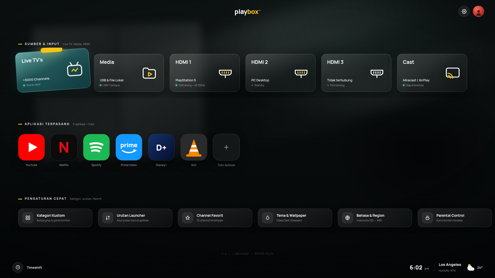

# Tiltbox Launcher 📺

**Tiltbox Launcher** adalah Android TV Launcher kustom berbobot ringan, berorientasi kinerja tinggi, dan berestetika modern yang dirancang khusus untuk Smart TV dan TV Box (dioptimalkan untuk TCL, Xiaomi, Android TV / Google TV).



---

## ✨ Fitur Utama

- **Karakter Visual Miring (-3.2°):** Kartu aktif yang disorot oleh remote kontrol mengalami rotasi halus `-3.2°` dan pembesaran skala (*zoom*), menciptakan identitas visual yang khas dan dinamis.
- **Top Spotlight Beam & Tab:** Pendaran lampu sorot eksklusif di bagian atas tengah kartu yang sedang dipilih, memberikan indikasi fokus D-Pad yang sangat jelas di layar TV.
- **Rasio Kartu 16:9 Borderless:** Struktur kartu 100% bebas border garis (*borderless*) dengan proporsi 16:9 yang proporsional dengan rasio layar televisi.
- **Navigasi 3 Baris Intuitif:**
  - **Baris 1 (Sumber & Input):** Akses langsung ke Siaran Live TV Digital (`com.tcl.tv`), Port HDMI 1/2/3, Media Player lokal (USB/Flashdisk), dan Wireless Screen Cast.
  - **Baris 2 (Aplikasi Terpasang):** Grid aplikasi favorit (YouTube, Netflix, Spotify, Vidio, Prime Video, VLC, dll.) dengan akses cepat ke App Store.
  - **Baris 3 (Pengaturan Cepat):** Manajemen kategori kustom, urutan baris, tema, dan setelan sistem TV.
- **Performa Ringan (Ultra Low RAM):** Dirancang tanpa bloatware Google TV, mengonsumsi memori minimal (~40–80 MB RAM) sehingga Smart TV dengan RAM terbatas (1.5 GB) tetap berjalan lancar bebas jeda (*lag-free*).
- **Cloud CI/CD Build:** Didukung oleh GitHub Actions untuk kompilasi APK otomatis di cloud tanpa membebani komputer lokal.

---

## 🛠️ Struktur Repositori

```text
tiltbox-launcher/
├── .github/workflows/
│   └── build-apk.yml          # Otomasi kompilasi APK via GitHub Actions
├── app/
│   ├── src/main/java/         # Kode sumber native Android / Leanback
│   │   └── com/amazon/tv/leanbacklauncher/
│   │       ├── animation/     # Mesin animasi fokus & rotasi -3.2°
│   │       └── apps/          # Manajemen kartu aplikasi & baris input
│   └── src/main/res/          # Sumber daya tata letak, string, dan tema
├── docs/
│   ├── playbox_consept.html   # Desain prototipe visual web interaktif
│   └── playbox_concept_render.png # Tangkapan layar render 1920x1080
└── build.gradle               # Konfigurasi Gradle
```

---

## 🚀 Pemasangan Cepat via ADB

Untuk memasang APK langsung ke Android TV melalui jaringan lokal (LAN/Wi-Fi):

```bash
# Hubungkan ke Android TV
adb connect <IP_TV>:5555

# Pasang APK Tiltbox Launcher
adb install -r TiltboxLauncher_v1.63-debug.apk

# Atur sebagai Default Home Launcher
adb shell cmd package set-home-activity com.amazon.tv.leanbacklauncher/.MainActivity
```

---

## 📄 Lisensi
Open-source under Apache-2.0 License.
Didedikasikan untuk pengalaman menonton Smart TV yang bersih dan responsif.
